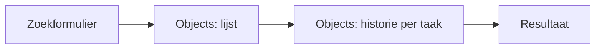

# ESF-controle

Zoekpagina waarmee functioneel beheerders nakijken of er voor een maand een ESF-taak bestaat en welke statussen die taak heeft gehad. Beheerders
hebben geen toegang tot de Objects API zelf. Deze pagina laat daarom alleen zien wat voor die controle nodig is. De pagina leest alleen en
verandert niets in Objects.

Een beheerder vult het periodenummer in (YYYYMM), kiest clientnummer of dossiernummer en vult de waarde in. Bij elke gevonden taak staan de periode,
het clientnummer, het dossiernummer, het object-UUID en alle records met index, status en registratiedatum, zoals ze in Objects staan. Herhaalde
statussen blijven staan: bij open, open, afgerond zijn dat drie regels.

## Zoeken

De lijst wordt gefilterd op het ESF-objecttype, soort formtaak, het periodenummer en het gekozen veld, allemaal exact. De periode is het veld
periodenummer in de taak. Aanmaak-, termijn- en verloopdatums doen niet mee, want die kunnen in een andere maand vallen. De browser kan geen eigen
veld of operator meegeven. Elk object wordt daarna in code nog een keer op die voorwaarden gecontroleerd.

Per taak komen alle records uit het history-endpoint, gesorteerd op index. De typeVersion is de schemaversie van het objecttype en geen
volgnummer. Een cliënt heeft per periode één taak en een taak wisselt nooit van periode, dus de historie wordt niet opnieuw op periode
gecontroleerd.

| Situatie | Wat de pagina doet |
|---|---|
| Niets gevonden | Meldt dat er geen ESF-taken zijn voor deze periode en zoekopdracht |
| Ongeldige invoer | Invoermelding, geen aanroep naar Objects |
| Geen recht of ongeldig CSRF-token | 403, geen aanroep naar Objects |
| Audit-start kan niet worden geschreven | Storingsmelding, geen aanroep naar Objects |
| Objects faalt, of de historie is niet compleet | Meldt een probleem met de Objects API, nooit een deelresultaat of "geen resultaat" |

Periodenummer is zes cijfers met een maand van 01 tot en met 12. Het nummer is maximaal 30 tekens en blijft een string, zoals in het
ESFTaak-schema, dus voorloopnullen blijven staan. Alleen een dubbele underscore wordt geweigerd, omdat de Objects API die in een filterwaarde niet accepteert.

## Rechten en audit

De pagina staat onder GET /esf en zoekt via POST /esf/zoeken, zodat de zoekwaarde niet in een URL terechtkomt. Zowel de sessie als het recht esf:view
worden in de Lambda gecontroleerd, ook voor globale admins. Het menu verbergen is geen beveiliging. De pagina heeft een eigen read-only token in een
eigen secret en valt nooit terug op een ander token. Responses zijn no-store.

Clientnummer en dossiernummer zijn herleidbaar naar een persoon. Ze staan alleen in het resultaat, niet in logs of audit. Die bevatten het zoektype,
de periode, aantallen, de uitkomst en de medewerker. De audit van de start wordt geschreven voordat Objects wordt aangeroepen en faalt dat
schrijven, dan volgt geen zoekactie. Dat wijkt af van recordAudit, dat fouten slikt.

## Keuzes

Een eigen Lambda en clientfactory houden het token los van Sport en Woonbehoefte, ten koste van wat herhaling. Er is geen cache of zoekindex: elke
zoekactie leest live, dus een zoekactie kost een lijstaanroep plus een historie-aanroep per taak. Veldautorisatie in de Objects API is bewust niet
gebruikt. De allowlist in de mapping is de grens: alleen periode, nummers, object-UUID en records gaan naar de view, nooit een ruwe response.
